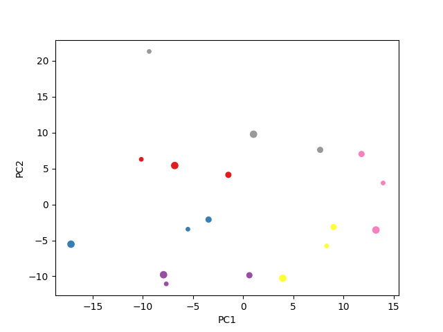
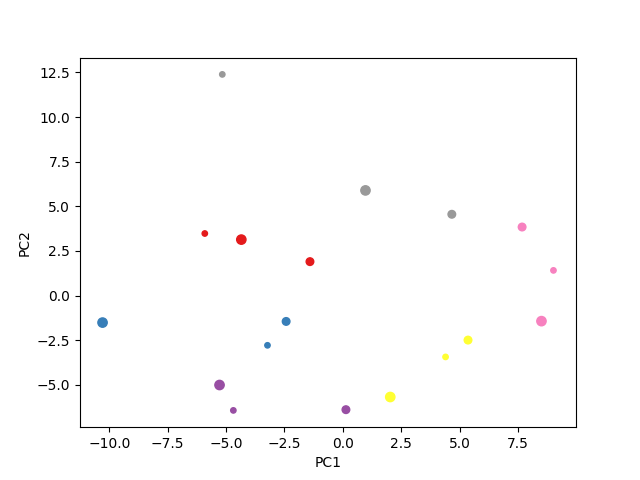
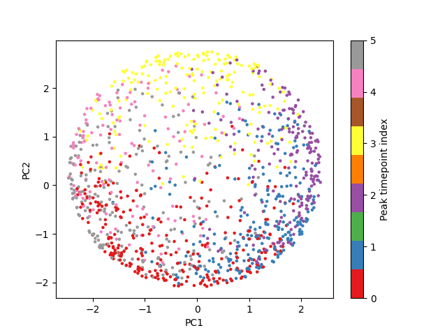
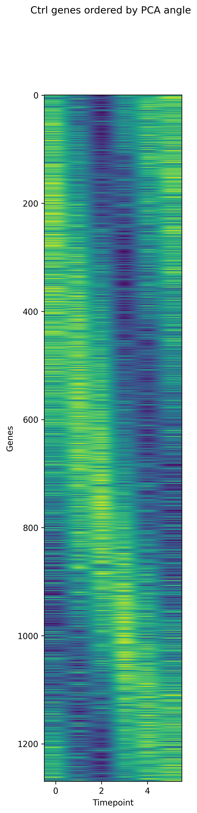
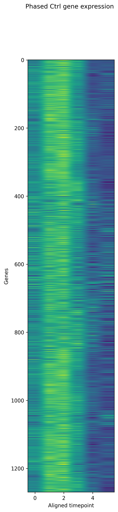
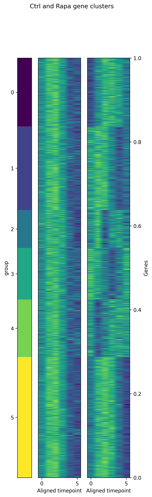

# Answers for Week 5
## Step 1.3: Plot the fisrt two PCs

Replicates from the same time point tend to occupy similar regions of the PCA plot, suggesting broadly similar gene expression profiles. However, they do not always cluster tightly. One blue point and one grey point are relatively far from their same-time replicates. I would generally expect replicates to be more similar to each other than samples from different time points because they were collected under the same comdition at the same time. The spread in this plot shows that there is also variation among replicates.

## Step 2.1: Filtering data by mean expression and scaled standard deviation

After filtering, the PCA plot looks similar to the original. Samples from the same time point still tend to occupy similar regions, but some replicates remain spread out, particularly in the blue and grey groups. It seems like filtering did not substaintially change the overall grouping pattern. Plus, the PC axes have a smaller numerical ranger after filtering, but PCA was recalculated using a different set of genes, so the coordinates values are not directly comparable. The overall pattern remains similar.

## Step 2.2 & 2.3

## Step 3.1: order expression times and plot data

## Step 3.2: Phase expression times and plot data

## Step 3.4: Plot the clustered data
